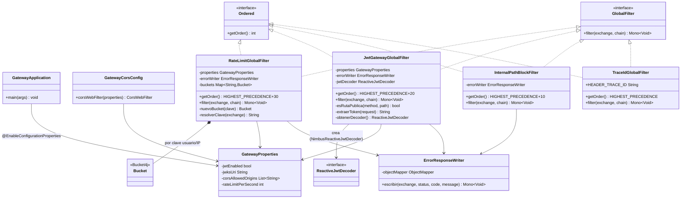

# ArtaGram — API Gateway (`artagram-gateway`)

Punto de entrada único HTTP y WebSocket (`/ws`) en el puerto `:8080`, construido sobre **Spring Cloud Gateway (WebFlux)**.

## Descripción del servicio

`artagram-gateway` es el único punto de entrada público de ArtaGram: todo el
tráfico HTTP y WebSocket del frontend pasa primero por este servicio antes de
llegar a cualquiera de los microservicios internos (`artagram-auth`,
`artagram-users`, `artagram-feed`, `artagram-chat`, `artagram-canvas`,
`artagram-payment`, `artagram-notifications`, y los workers de media/IA).
Implementado sobre Spring Cloud Gateway en modo reactivo (WebFlux), su rol no
es exponer lógica de negocio propia sino centralizar los *cross-cutting
concerns* que, de otro modo, cada microservicio tendría que reimplementar por
su cuenta: a qué backend enrutar cada ruta, quién puede entrar sin sesión,
quién tiene permisos de administrador, cuántas peticiones por segundo se
permiten y cómo se correlacionan los logs de una misma petición entre
servicios. Existir como servicio separado (en vez de resolver esto en cada
microservicio) evita duplicar la validación de JWT y el throttling nueve
veces, permite cambiar el enrutamiento vía configuración/variables de entorno
sin tocar código de negocio, y da un único lugar para bloquear tráfico
indebido (por ejemplo rutas `/internal/**`) antes de que llegue a la red
interna.

## Responsabilidades
- **Enrutamiento Strangler Fig:** Redirige cada prefijo de API (`/api/auth/**`, `/api/perfiles/**`, `/api/feed/**`, `/api/mensajes/**`, `/api/comunidades/**`, `/ws/**`) al microservicio correspondiente (configurable por variables de entorno).
- **Seguridad perimetral:**
  - Bloquea todas las rutas `/internal/**` desde el exterior (`403 SIN_PERMISO`).
  - Valida tokens JWT RS256 contra el endpoint `/.well-known/jwks.json` de `artagram-auth` (`GATEWAY_JWT_ENABLED=true`) y propaga `X-User-Id`, `X-User-Name` y `X-User-Role`.
  - Restringe `/api/admin/**` exclusivamente a tokens con claim `rol=ADMIN`, devolviendo `403 SIN_PERMISO` en caso contrario.
  - Define una lista explícita de rutas públicas (sin JWT) en `JwtGatewayGlobalFilter.esRutaPublica()`: `/api/auth/**`, `/.well-known/jwks.json`, `/media/**`, `/ws`, `/actuator/health`, `/actuator/prometheus`, `/swagger-ui`, `/v3/api-docs`, `/api/pagos/webhook/**` y `GET /api/perfiles/**` (excepto `/premium`).
- **Rate Limiting:** Bucket4j por usuario autenticado (`X-User-Id`) o dirección IP (`429 LIMITE_PETICIONES`), con límite configurable (`GATEWAY_RATE_LIMIT_PER_SEC`).
- **Trazabilidad y CORS:** Genera y propaga `X-Trace-Id` (lo inyecta en MDC para logs) y centraliza CORS (`CORS_ORIGINS`), incluyendo deduplicación de cabeceras `Access-Control-Allow-*` en `default-filters`.
- **Contrato de errores uniforme:** `ErrorResponseWriter` serializa toda respuesta de error del gateway (401/403/429) con el mismo formato JSON (`code`, `message`, `traceId`, `violations`) que el resto de la plataforma.
- **Observabilidad:** expone `/actuator/health`, `/actuator/prometheus` y `/actuator/gateway` para monitoreo externo.

## Diagrama de clases

El orden de ejecución de los filtros globales está fijado por `getOrder()`
(`Ordered`): `TraceIdGlobalFilter` (HIGHEST_PRECEDENCE) → `InternalPathBlockFilter`
(+10) → `JwtGatewayGlobalFilter` (+20) → `RateLimitGlobalFilter` (+30), de
forma que cada petición ya tiene trace id antes de ser bloqueada, autenticada
y luego limitada en tasa.

## Atributos de calidad

### Seguridad

El gateway es el único punto donde se valida JWT y se filtran rutas internas
antes de que la petición llegue a cualquier microservicio (`JwtGatewayGlobalFilter`,
`InternalPathBlockFilter`).

- **Fuente:** un cliente externo (navegador, script o actor malicioso) sin
  sesión válida o sin el rol requerido.
- **Estímulo:** envía una petición `GET /api/admin/kpis` sin token, con un
  token expirado/inválido, o con un token válido pero sin claim `rol=ADMIN`.
- **Artefacto:** `JwtGatewayGlobalFilter` + `ErrorResponseWriter`.
- **Ambiente:** operación normal en producción, con `GATEWAY_JWT_ENABLED=true`.
- **Respuesta:** el filtro intercepta la petición antes de reenviarla al
  backend (`artagram-users`), decodifica y valida el JWT contra el JWKS de
  `artagram-auth`; si falta, es inválido o el rol no es `ADMIN`, responde
  `401 NO_AUTENTICADO` o `403 SIN_PERMISO` en el formato JSON estándar y **no**
  reenvía la petición a la red interna.
- **Medida de respuesta:** el 100% de las peticiones a rutas protegidas sin
  token válido o sin el rol correcto son rechazadas en el propio gateway (0
  llegan al microservicio interno); el mismo mecanismo bloquea el 100% de los
  intentos externos de acceder a `/internal/**` vía `InternalPathBlockFilter`.

### Modificabilidad

Las rutas a microservicios se externalizan a `application.yml`/variables de
entorno (patrón Strangler Fig), pero la lista de rutas públicas vive
hardcodeada en Java (`JwtGatewayGlobalFilter.esRutaPublica()`), duplicando
conocimiento que ya existe en las rutas del `application.yml`.

- **Fuente:** un desarrollador del equipo de ArtaGram.
- **Estímulo:** necesita agregar un nuevo backend (ej. `ai-worker`) con una
  ruta protegida por JWT, y por separado necesita exponer una ruta nueva sin
  autenticación (pública).
- **Artefacto:** `application.yml` (bloque `spring.cloud.gateway.routes`) y
  `JwtGatewayGlobalFilter`.
- **Ambiente:** tiempo de mantenimiento/despliegue, antes de poner el cambio
  en producción.
- **Respuesta:** agregar un backend con rutas que requieren JWT solo exige
  añadir un bloque `routes` y una variable `*_SERVICE_URL` en `application.yml`,
  sin tocar ni recompilar código Java. En cambio, si la ruta nueva debe ser
  pública, el desarrollador debe además editar y recompilar
  `esRutaPublica()` en `JwtGatewayGlobalFilter`, repitiendo un patrón de ruta
  que ya está declarado en el YAML.
- **Medida de respuesta:** agregar una ruta protegida nueva requiere modificar
  1 archivo de configuración (`application.yml`) y 0 archivos Java; agregar
  una ruta pública nueva requiere modificar y recompilar al menos 1 clase
  Java adicional, con riesgo de inconsistencia entre YAML y código si se
  olvida uno de los dos lugares.

### Escalabilidad

El rate limiter (`RateLimitGlobalFilter`) guarda los `Bucket` de Bucket4j en
un `ConcurrentHashMap` **en memoria, local a cada instancia**, no en un
backend compartido (Redis/ElastiCache).

- **Fuente:** el equipo de operaciones, al escalar horizontalmente el gateway
  detrás de un load balancer para soportar más tráfico.
- **Estímulo:** se despliegan N instancias del gateway (por ejemplo N=3 en
  ECS Fargate) detrás de un balanceador que reparte peticiones del mismo
  cliente entre instancias distintas.
- **Artefacto:** `RateLimitGlobalFilter` (`Map<String, Bucket> buckets` local
  por instancia, límite configurado en `rateLimitPerSecond`).
- **Ambiente:** producción, con el servicio escalado a múltiples réplicas sin
  estado compartido.
- **Respuesta:** cada instancia mantiene su propio mapa de buckets, sin
  sincronizarlo con las demás, por lo que el límite de tasa real por
  usuario/IP depende de a cuántas instancias distintas el balanceador enrute
  sus peticiones, en vez de aplicarse un límite global único.
- **Medida de respuesta:** con N=3 instancias y
  `GATEWAY_RATE_LIMIT_PER_SEC=120`, un mismo cliente puede alcanzar hasta
  ~360 peticiones/s reales antes de que *todas* las instancias lo bloqueen,
  hasta 3x el límite nominal configurado — esto es aceptable mientras el
  servicio corra en una sola instancia o detrás de *sticky sessions*, pero
  requeriría migrar a un backend distribuido (`bucket4j-redis`) para que el
  límite sea exacto al escalar horizontalmente.

## Diseño y Arquitectura

Servicio deliberadamente delgado: 8 clases, sin capa de dominio porque no tiene
estado propio — es puro enrutamiento y cross-cutting concerns sobre WebFlux.
(Ver el diagrama de clases completo en la sección "Diagrama de clases" arriba.)

### Evaluación SOLID

- **SRP — bien aplicado.** Cada filtro tiene una sola razón de cambio:
  `TraceIdGlobalFilter` solo trazabilidad, `InternalPathBlockFilter` solo
  bloqueo de `/internal/**`, `JwtGatewayGlobalFilter` solo autenticación,
  `RateLimitGlobalFilter` solo throttling. `ErrorResponseWriter` centraliza el
  único punto que serializa errores, evitando que cada filtro reinvente el
  formato JSON.
- **OCP — bien aplicado donde importa más.** Un filtro nuevo es una clase
  nueva `@Component implements GlobalFilter, Ordered`; Spring la descubre y
  la ordena sola, sin tocar las existentes. Las rutas a microservicios viven
  en `application.yml` vía variables de entorno (`AUTH_SERVICE_URL`, etc.),
  así que agregar un backend nuevo no toca código Java.
  **Punto débil real:** la lista de rutas públicas (`esRutaPublica()` en
  `JwtGatewayGlobalFilter`) está *hardcodeada* en Java y duplica conocimiento
  que ya vive en las rutas de `application.yml` — agregar un endpoint público
  nuevo exige tocar y recompilar esta clase en vez de solo la config.
  Externalizarla a `GatewayProperties` (una lista de patrones) cerraría esta
  brecha de verdad.
- **LSP — sin violaciones.** Los cuatro filtros son sustituibles entre sí
  como `GlobalFilter`; ninguno estrecha precondiciones ni cambia el contrato.
- **ISP — correcto.** `GlobalFilter` (Spring Cloud Gateway) ya expone un solo
  método; no hay interfaces infladas que forzar a implementar de más.
- **DIP — parcialmente violado en un punto concreto.** `JwtGatewayGlobalFilter`
  construye su propio `ReactiveJwtDecoder` perezosamente con double-checked
  locking dentro del filtro (`obtenerDecoder()`), en vez de recibirlo como un
  `@Bean` inyectado desde una `@Configuration`. Esto mezcla responsabilidad de
  construcción con la de filtrado, y el segundo constructor (3 argumentos)
  solo existe para que los tests puedan inyectar un decoder — código muerto
  en el camino de producción real. Moverlo a un método `@Bean` sería más
  idiomático y testeable sin el constructor extra.

### Puntos de extensibilidad reales

- Nuevo filtro transversal → nueva clase `GlobalFilter`/`Ordered`, cero cambios en las demás.
- Nueva ruta/backend → variable de entorno + bloque en `application.yml`.
- Nuevo límite/comportamiento → nuevo campo en `GatewayProperties`, sin tocar lógica.

### Preparación para AWS

- **Cómputo:** sin estado propio (los buckets de rate-limit son locales por
  instancia, no compartidos) → candidato directo a ECS Fargate o EKS detrás
  de un **ALB**, escalado horizontal simple. Si se necesita rate-limit
  *compartido* entre instancias, migrar `RateLimitGlobalFilter` de buckets
  en memoria a Redis/**ElastiCache** (Bucket4j ya soporta un backend
  distribuido vía `bucket4j-redis`, cambio acotado a esa clase).
- **TLS:** terminar TLS en el ALB (ACM) y dejar el contenedor en HTTP interno,
  o terminarlo en el propio gateway si se requiere mTLS interno — no hay
  código aquí que lo bloquee ni lo asuma.
- **Secretos:** `GATEWAY_JWT_ENABLED`/`AUTH_JWKS_URI` son config, no secretos;
  este servicio no maneja credenciales propias, así que no necesita
  integración con Secrets Manager/Parameter Store directamente.
- **Observabilidad:** ya expone `/actuator/prometheus` — apuntar un
  CloudWatch Agent/ADOT collector ahí sin cambios.
- **CORS_ORIGINS:** verificar que apunte al dominio real del frontend en AWS
  (CloudFront/S3 o Amplify), no a `localhost:5173`.
