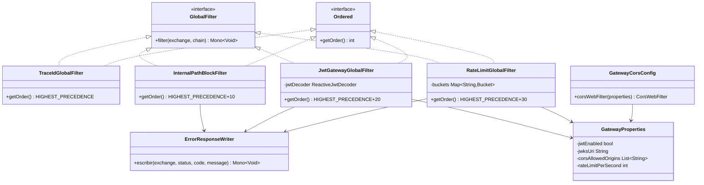

# ArtaGram — API Gateway (`artagram-gateway`)

Punto de entrada único HTTP y WebSocket (`/ws`) en el puerto `:8080`, construido sobre **Spring Cloud Gateway (WebFlux)**.

## Responsabilidades
- **Enrutamiento Strangler Fig:** Redirige cada prefijo de API (`/api/auth/**`, `/api/perfiles/**`, `/api/feed/**`, `/api/mensajes/**`, `/api/comunidades/**`, `/ws/**`) al microservicio correspondiente (configurable por variables de entorno).
- **Seguridad perimetral:**
  - Bloquea todas las rutas `/internal/**` desde el exterior (`403 SIN_PERMISO`).
  - Valida tokens JWT RS256 contra el endpoint `/.well-known/jwks.json` de `artagram-auth` (`GATEWAY_JWT_ENABLED=true`) y propaga `X-User-Id`, `X-User-Name` y `X-User-Role`.
- **Rate Limiting:** Bucket4j por usuario autenticado (`X-User-Id`) o dirección IP (`429 LIMITE_PETICIONES`).
- **Trazabilidad y CORS:** Genera y propaga `X-Trace-Id` y centraliza CORS (`CORS_ORIGINS`).

## Diseño y Arquitectura

Servicio deliberadamente delgado: 8 clases, sin capa de dominio porque no tiene
estado propio — es puro enrutamiento y cross-cutting concerns sobre WebFlux.

### Evaluación SOLID

- **SRP — bien aplicado.** Cada filtro tiene una sola razón de cambio:
  `TraceIdGlobalFilter` solo trazabilidad, `InternalPathBlockFilter` solo
  bloqueo de `/internal/**`, `JwtGatewayGlobalFilter` solo autenticación,
  `RateLimitGlobalFilter` solo throttling. `ErrorResponseWriter` centraliza el
  único punto que serializa errores, evitando que cada filtro reinvente el
  formato JSON.
- **OCP — bien aplicado donde importa más.** Un filtro nuevo es una clase
  nueva `@Component implements GlobalFilter, Ordered`; Spring la descubre y
  la ordena sola, sin tocar las existentes. Las rutas a microservicios viven
  en `application.yml` vía variables de entorno (`AUTH_SERVICE_URL`, etc.),
  así que agregar un backend nuevo no toca código Java.
  **Punto débil real:** la lista de rutas públicas (`esRutaPublica()` en
  `JwtGatewayGlobalFilter`) está *hardcodeada* en Java y duplica conocimiento
  que ya vive en las rutas de `application.yml` — agregar un endpoint público
  nuevo exige tocar y recompilar esta clase en vez de solo la config.
  Externalizarla a `GatewayProperties` (una lista de patrones) cerraría esta
  brecha de verdad.
- **LSP — sin violaciones.** Los cuatro filtros son sustituibles entre sí
  como `GlobalFilter`; ninguno estrecha precondiciones ni cambia el contrato.
- **ISP — correcto.** `GlobalFilter` (Spring Cloud Gateway) ya expone un solo
  método; no hay interfaces infladas que forzar a implementar de más.
- **DIP — parcialmente violado en un punto concreto.** `JwtGatewayGlobalFilter`
  construye su propio `ReactiveJwtDecoder` perezosamente con double-checked
  locking dentro del filtro (`obtenerDecoder()`), en vez de recibirlo como un
  `@Bean` inyectado desde una `@Configuration`. Esto mezcla responsabilidad de
  construcción con la de filtrado, y el segundo constructor (3 argumentos)
  solo existe para que los tests puedan inyectar un decoder — código muerto
  en el camino de producción real. Moverlo a un método `@Bean` sería más
  idiomático y testeable sin el constructor extra.

### Puntos de extensibilidad reales

- Nuevo filtro transversal → nueva clase `GlobalFilter`/`Ordered`, cero cambios en las demás.
- Nueva ruta/backend → variable de entorno + bloque en `application.yml`.
- Nuevo límite/comportamiento → nuevo campo en `GatewayProperties`, sin tocar lógica.

### Preparación para AWS

- **Cómputo:** sin estado propio (los buckets de rate-limit son locales por
  instancia, no compartidos) → candidato directo a ECS Fargate o EKS detrás
  de un **ALB**, escalado horizontal simple. Si se necesita rate-limit
  *compartido* entre instancias, migrar `RateLimitGlobalFilter` de buckets
  en memoria a Redis/**ElastiCache** (Bucket4j ya soporta un backend
  distribuido vía `bucket4j-redis`, cambio acotado a esa clase).
- **TLS:** terminar TLS en el ALB (ACM) y dejar el contenedor en HTTP interno,
  o terminarlo en el propio gateway si se requiere mTLS interno — no hay
  código aquí que lo bloquee ni lo asuma.
- **Secretos:** `GATEWAY_JWT_ENABLED`/`AUTH_JWKS_URI` son config, no secretos;
  este servicio no maneja credenciales propias, así que no necesita
  integración con Secrets Manager/Parameter Store directamente.
- **Observabilidad:** ya expone `/actuator/prometheus` — apuntar un
  CloudWatch Agent/ADOT collector ahí sin cambios.
- **CORS_ORIGINS:** verificar que apunte al dominio real del frontend en AWS
  (CloudFront/S3 o Amplify), no a `localhost:5173`.
